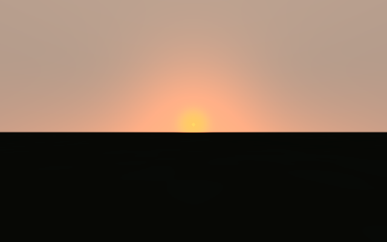
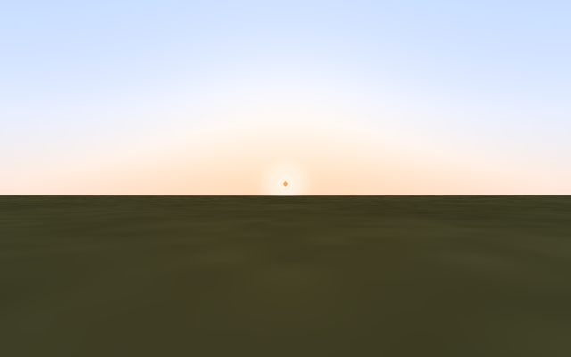
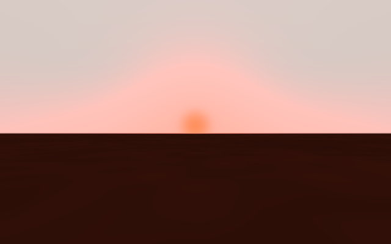
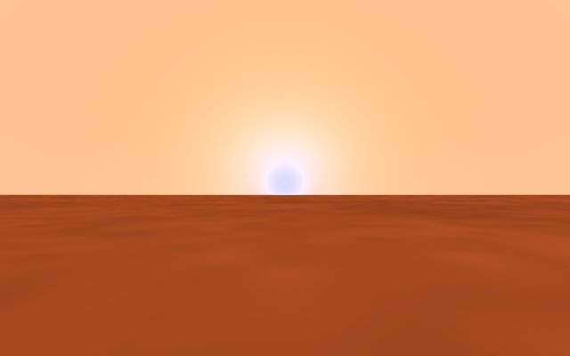

# Sky mathematics and colour review

Reviewed 6 September 2026, against the original committed implementation.

The original was a useful, visually plausible atmospheric illustration with
real physical ingredients. It was not a reliable predictor of exact sky colour
or brightness. Earth's daytime blue sky was convincing; several sunset,
twilight, dust and surface-lighting behaviours were inconsistent. The revised
version corrects those inconsistencies and improves qualitative colour behaviour,
while remaining an approximate renderer.

## What was already sound

- Rayleigh scattering followed the expected wavelength-to-the-minus-fourth
  dependence. Hydrostatic molecular column scaling used pressure, gravity,
  molecular mass and a gas cross-section mixture.
- Stellar flux used inverse-square distance scaling.
- Direct-beam transmission used exponential optical attenuation.
- Aerosol extinction, forward scattering, molecular absorption, cloud cover and
  exposure were represented separately.

The main problem was how these ingredients were combined, and how strongly the
comments implied a physically validated radiative-transfer calculation.

## Corrections

| Area | Original behaviour | Change |
| --- | --- | --- |
| Horizon path | The Sun's path stopped changing below +1°; the air-mass helper also altered the formula below +0.5°. | Restored Kasten–Young on 0–90° and share its result with the shader. Horizon air mass is about 37.92, previously 26.31 in the renderer. Below-horizon use is explicitly a proxy. |
| Earth calibration | The Earth optical depth was multiplied by an N₂-relative mixture factor a second time. | Normalize the gas mixture to Earth air: standard Earth optical depth at 550 nm is 0.099 as intended, rather than 0.09677. |
| Single scattering | Scattering coefficient multiplied by both full-path transmissions omitted the integral along the line of sight. Rayleigh and aerosol phase functions used different normalization conventions. | Integrate single scattering through a uniform optical-depth slab, including stable equal-path and transparent limits. Use mean-one phase functions for both components. |
| Direct sunlight | The normalized Sun tint already contained stellar colour and extinction, but the shader applied stellar colour again; ground lighting applied transmission again as well. | Pass absolute transmitted RGB once. The disc and terrain receive the same beam. |
| Dust colour | The broad multiple-scattering term ignored aerosol tint. Aerosol phase asymmetry was identical in all colour channels. | Apply aerosol tint consistently. Support per-channel asymmetry. Mars uses near-grey extinction and a narrower blue forward lobe. |
| Mars sunset | Rendered orange/red near the Sun; description incorrectly attributed an expected blue glow to Rayleigh scattering. | The rendered glow is blue close to the Sun and the surrounding dusty sky stays warm. The dust parameters are explicitly a qualitative fit. |
| Earth sunset | A reddened beam tinted the entire diffuse hemisphere. | Concentrate this empirical warming toward the sunward horizon, preserving a cooler upper sky. |
| Twilight | Scalar lux decayed exponentially, while much of the rendered sky retained daylight illumination. Eye gain could wash twilight almost white. A second hidden fade also changed fixed-camera exposure. | Share one empirical twilight-light factor across solar scattering and diffuse surface light. Fixed-camera exposure stays fixed; remove the residual daylight floor and retune illustrative night light. |
| Surface illuminance | Direct horizontal light lacked its sine-of-elevation projection. Diffuse light existed even in vacuum and purely absorbing media. | Add the projection; require actual scatterers for diffuse light. `downwell` now means diffuse light, and cloud diffusion also illuminates terrain. |
| Display colour | Hex surface colours were converted from sRGB twice. Output used approximate gamma; bright RGB channels could clip independently. | Convert surface input once, encode output with the sRGB transfer function, and fit bright colours into gamut with a common RGB scale. |
| Stellar disc | Used `atan(R/d)` for a sphere and imposed a minimum apparent radius of 0.002 radians. | Use `asin(R/d)` and preserve small distant stars. The horizon clips the disc instead of fading the whole disc as its centre sets. |
| Fictional sodium effect | Colour jumped abruptly at 15° elevation. | Blend the preset styling continuously. |

Kasten–Young's formula and its apparent-elevation domain were checked against
[pvlib's reference implementation](https://pvlib-python.readthedocs.io/en/stable/_modules/pvlib/atmosphere.html).
Transmission and phase-function conventions were checked against
[PBRT: Transmittance](https://pbr-book.org/4ed/Volume_Scattering/Transmittance) and
[PBRT: Phase Functions](https://pbr-book.org/4ed/Volume_Scattering/Phase_Functions).
Three.js automatically converts hexadecimal input into its linear working space,
as documented in [Three.js colour management](https://threejs.org/manual/en/color-management.html).

NASA describes the Martian blue sunset glow as a dust-scattering effect,
concentrated near the Sun. This supports the qualitative behaviour targeted
here; it does **not** supply or validate this renderer's fitted dust coefficients.
See [NASA's Curiosity sunset explanation](https://science.nasa.gov/resource/sunset-at-mars-gale-crater-curiosity/).

## Before/after measurements

Captured at the same +2° Sun elevation and adapted exposure settings:

| World | Original | Revised |
| --- | --- | --- |
| Earth |  |  |
| Mars |  |  |

Same presets, exposure 1, human-eye adaptation enabled, standard aerosols and
absorption. RGB entries are individual 8-bit sRGB pixels from a 640×400 Chromium
WebGL render at a fixed camera position. They demonstrate changes and regressions;
they are not comparisons against calibrated sky observations.

| Case | Original | Revised |
| --- | --- | --- |
| Moon, Sun +2°, estimated horizontal light | 91,181 lux | 4,642 lux |
| Earth, Sun +2°, estimated horizontal light | 9,167 lux | 1,947 lux |
| Earth, Sun −6°, sky away from disc | RGB 255, 218, 221: almost white | RGB 48, 44, 40: dim twilight |
| Earth, Sun +2°, upper view | RGB 197, 163, 142: warm | RGB 222, 234, 255: cooler |
| Mars, Sun +2°, near Sun | RGB 255, 148, 101: orange | RGB 222, 220, 255: blue/lavender |
| Mars, Sun +2°, away from Sun | RGB 255, 194, 185 | RGB 255, 196, 148: warm dust |

For the airless Moon, the revised value follows the model's solar illuminance
constant times `sin(2°)` directly. This is a useful geometric check, rather than
a new calibration of the constant. Other lux estimates remain heuristic.

## How accurate are the colours now?

Confidence is good in the **broad trends** covered by tests: Earth blue daytime
sky, warmer sunset horizon with cooler upper sky, localized blue Martian sunset
glow, methane suppressing red, and no atmospheric sky glow in vacuum. Exact hue,
saturation, luminance, twilight duration and cloud appearance remain unvalidated.

Important limits:

- Three wavelengths are used as RGB proxies. There is no spectral integration
  against human colour-matching functions, measured stellar spectrum or observer
  white adaptation. Tone mapping and exposure also change the displayed result.
- CH₄/O₃ strengths and gas cross-section ratios remain approximate preset
  parameters. In particular, the ozone RGB weights are not measured Chappuis-band
  optical depths, so toggling ozone is illustrative rather than quantitative.
- Aerosol optical depths, tints and size-dependent scattering are not fitted to
  observations for each preset. The revised Mars model is a qualitative fit,
  not a Mie calculation using measured dust sizes and refractive indices.
- The uniform slab, Earth air-mass fit, empirical twilight curve, display gains,
  cloud mixing and multiple-scattering fill are not a spherical atmospheric
  radiative-transfer solution. Scale height is displayed but does not set the
  curved path geometry. Planet radius and vertical atmospheric profiles are
  absent. Thick-atmosphere and giant-planet colours are especially approximate.
- Lux uses a green-channel proxy and solar conversion factor even for other
  stellar temperatures. It is neither spectrally calibrated nor obtained by
  integrating the rendered hemisphere. Eye gain is a power-law display aid,
  not a full retinal response model.
- Sunrise/sunset buttons animate elevation at a chosen azimuth. They do not
  calculate times from location/date, orbital geometry, seasons or planetary
  rotation. Refraction is not computed; the slider is treated as apparent
  elevation for the air-mass fit. Real sunrise definitions include refraction,
  as explained by [NOAA](https://gml.noaa.gov/grad/solcalc/calcdetails.html).
- Exoplanet atmospheres and fictional world parameters are scenarios, not known
  surface conditions. An exact predicted colour would imply unsupported precision.

## Validation and reproduction

- `npm test`: 13 numerical/colour-conversion/binding checks, including a sweep
  across all 23 worlds, horizon elevations, aerosol amounts and absorption states.
- `npm run build`: TypeScript checking and production build.
- Start `npm run dev` and open `/tests/sky-render.html`: 14 actual WebGL checks,
  a rendered gallery, and a shader smoke sweep across every world at −15°, 0°
  and +85°. Checks test colour relationships rather than brittle exact pixels.
- The browser checks passed in headless Chromium with software WebGL and no
  shader compilation or linking errors. Production build passes; Vite retains
  its existing large-bundle advisory.

These checks guard physical limits and intended qualitative colours. Establishing
numerical colour accuracy would require measured atmospheric inputs and comparison
with a spectral spherical radiative-transfer reference.
