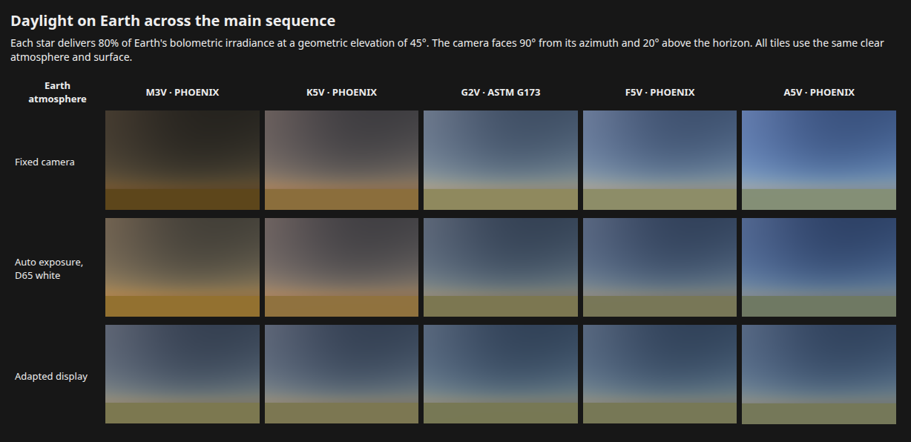
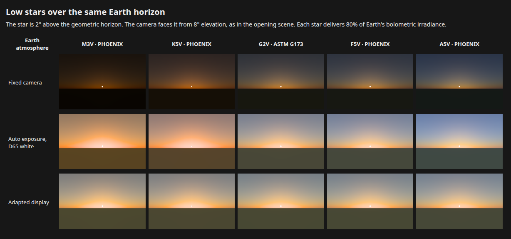

# How the host star changes an Earth sky

The opening view makes different hosts look surprisingly alike. It faces the star at a geometric elevation of 2°, where the long atmospheric path removes much of the blue from the direct beam. The display then adapts to the brightness and colour of each scene and compresses bright highlights into the screen's range. There was also a physical bias. The previous stellar blackbodies supplied too much visible light for the M3V comparison and too little for the A5V comparison.

## The same Earth under five stars

Each column uses the same cloud-free Earth atmosphere, haze, pressure, surface reflectance and top-of-atmosphere irradiance of 1088.8 W/m². Only the star and its orbital distance change. The comparison places the Sun at 1.118 AU to match the other hosts. The ordinary Earth preset opens at 1 AU. The comparison uses the production sky and display shaders with terrain and companions suppressed to isolate atmospheric light. Each row uses a common display setting.

With the star 45° high, the camera looks 20° above the horizon and 90° around from the star. Ground illuminance includes direct and diffuse light on a horizontal surface. The blue:red ratio comes from the linear sRGB sky radiance at the centre pixel before any display adjustment. It compares broad colour channels and depends on the viewing direction.

| Host | Ground illuminance (klux) | Blue:red sky radiance | Side sky with automatic exposure and fixed D65 white (8-bit sRGB) |
|---|---:|---:|---|
| M3V | 15.1 | 0.58 | 93, 86, 71 |
| K5V | 42.0 | 0.89 | 90, 86, 85 |
| G2V (Sun) | 67.8 | 2.09 | 74, 89, 106 |
| F5V | 72.2 | 2.65 | 71, 89, 114 |
| A5V | 74.0 | 4.08 | 65, 90, 128 |

At the opening geometry the blue:red ratio still ranges from 0.061 (M3V) to 0.479 (A5V). Yet the centre pixel in adapted display is warm orange in both cases, sRGB (255, 198, 129) and (246, 198, 135). The daylight and low-star comparisons show why a single sunset is a poor diagnostic for the stellar spectrum. To explore the difference, raise **Stellar elevation** to 45°, look a quarter turn away from the star and turn off **Adapt white balance to star** in **Display**. **Fixed camera** also holds exposure constant. [HDR values and screen pixels for every host and condition](render-results.json)

## Checks on the science and rendering

| Stage | Independent check and finding |
|---|---|
| Stellar input | Eight catalogue hosts now use PHOENIX BT-Settl model spectra at solar metallicity and assumed surface gravity. The maximum difference in photopic luminous efficacy between the 48-band tables and a separate integration of the native spectra with the 1 nm CIE observer is under 0.04%. For the M3V case, replacing the blackbody lowered the modeled ground illuminance from 24.4 to 15.1 klux at 45°. The comparison isolates this important cool-star bias. |
| Single scattering | For an optically thin atmosphere lit from the zenith, the scattered intensity has an analytic solution proportional to incident spectral irradiance, the Rayleigh phase function, and τ exp(−τ). The rendered zenith agrees within 0.3% in each linear colour channel for all five hosts. |
| Layer integration | Different paths previously gave vertical optical depths of 0.375, 1.957 and 4.294 for the same narrow cloud with a specified depth of 1. Sampling the physical layer on each ray recovers unity on both curved and straight paths. A separate GPU foreground test gives transmission 0.50521 against an analytic 0.50526 for a cloud centred at the surface. |
| Emission and higher scattering orders | Treating each layer's sources as distributed through its optical depth restores the isothermal slab equilibrium and makes uniform sources invariant to layer subdivision. In a purely absorbing slab of optical depth 3, the former calculation emitted 0.299 times the equilibrium blackbody flux per side. The corrected two-stream calculation gives 0.998, equal to the slab's absorptivity within that closure. |
| Display and night sky | Early clipping of signed RGB inflated the displayed luminance of a saturated 480 nm test light by 38%. The screen conversion now preserves the tone-mapped luminance. Correcting the catalogue's additive blending also restores stars whose contributions had vanished in the GPU pass. A 2.54 µlx test star supplies 2.5395 µlx to the HDR buffer. |

The stellar inputs are representative model photospheres. The stellar grid and regeneration script record the temperature brackets, assumed gravities, input checksums and full-resolution photometry. Freeform custom stars still use Planck spectra. [STScI stellar grid](https://ssb.stsci.edu/cdbs/grid/phoenix/) · [CIE colour matching functions](https://cie.co.at/datatable/cie-1931-colour-matching-functions-2-degree-observer) · [Photometric reference and input hashes](stellar-reference.json) · [Table generator](../../tools/build-stellar-spectra.py)

## Terrestrial reference checks

Kider and colleagues measured directional sky spectra at Cornell University. For each scan, the simulator used the stock Earth atmosphere and the solar position and distance at the recorded time. The comparison covers the zenith and the average of 24 directions at 33.75° elevation. The modeled zenith was less blue than the observations in all three scans. In the lowest-Sun case, measured CIE (x, y) was (0.2431, 0.2537) and the model gave (0.2560, 0.2672). The ring average agreed most closely at a solar elevation of 41° and was 25% too bright under the highest Sun. The preset uses sea-level pressure and prescribed aerosol and surface properties. The field scan takes about three minutes. [Field comparison and reproduction instructions](measured-zenith.md) · [Original measurements](https://github.com/spectralskylight/sky-measurements-2014)

| Solar elevation | Zenith, measured / modeled (cd/m²) | Difference | Ring mean, measured / modeled (cd/m²) | Difference |
|---|---:|---:|---:|---:|
| 9.14° | 659 / 765 | +16.1% | 1476 / 1771 | +20.0% |
| 41.06° | 2081 / 2068 | −0.6% | 4132 / 4128 | −0.1% |
| 65.15° | 3842 / 4168 | +8.5% | 3059 / 3836 | +25.4% |

For the ASTM G173-03 air-mass-1.5 case, the Sun was 41.81° high, surface pressure was 1.01325 bar, ozone was 340 DU, and aerosol optical depth at 500 nm was 0.084. Weighting the published SMARTS direct-plus-circumsolar spectrum by the CIE photopic response gives 97,142 lx normal to the beam. Skymuse gives 97,886 lx for the direct beam, **0.77% higher**. The ASTM reference includes light close to the solar disc and additional absorbers and atmospheric layers. This tests one daylight condition. [ASTM G173-03 tables and conditions](https://www.nlr.gov/grid/solar-resource/spectra-am1.5) · [Photometric regression](../../tests/stellar-spectrum.test.mjs)

| Band centre | Reference transmission across 10 nm | Skymuse transmission |
|---|---:|---:|
| 440 nm | 0.601 | 0.599 |
| 550 nm | 0.732 | 0.735 |
| 680 nm | 0.847 | 0.848 |
| 760 nm | 0.574 | 0.889 |

The 760 nm miss matters for interpreting the model. Oxygen is present in Earth's Rayleigh-scattering mixture, but its A-band absorption is missing. Low human photopic sensitivity at this wavelength allows a good integrated lux result to coexist with a large spectral error. Water-vapour absorption is also missing. The 10 nm transport averages over narrow lines even for gases with absorption data.

## Where the pictures remain uncertain

The model prescribes the same Earth atmosphere for the K, M, F and A alternatives. Their orbits lie inside one-Earth-mass habitable-zone fits. Surface temperature, ozone, clouds and haze would also respond to the star's spectrum over time. The presets isolate illumination and do not calculate those climate or photochemical responses. [Orbital distances and climate-fit sources](../science-model.md#earth-comparisons-around-other-stars)

Prescribed particle sizes and phase functions limit interpretation of Mars dust, Titan haze, and thick Venus clouds. The hemispheric two-stream treatment approximates how multiply scattered light varies with direction. It has the greatest uncertainty in thick atmospheres and twilight. Refraction is achromatic, and stellar activity, spatially varying weather and the angular response of the human retina are outside the model. An SDR image shows the predicted relative appearance under the named display assumptions. [Model and limitations](../science-model.md)

Run `npm test` for the physical checks. On a running dev server, `/tests/sky-render.html` regenerates the two comparison grids and 24 GPU checks. The catalogue smoke check also exercised all 27 presets at stellar elevations of −20° and +45°, including their companion illumination.
